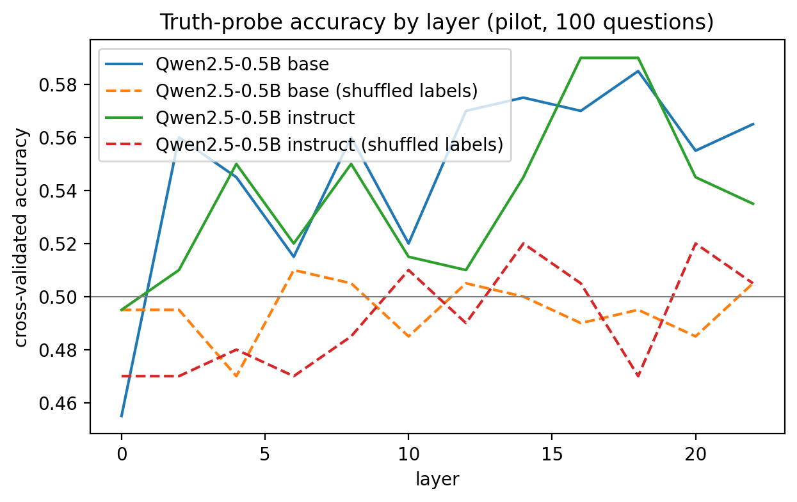
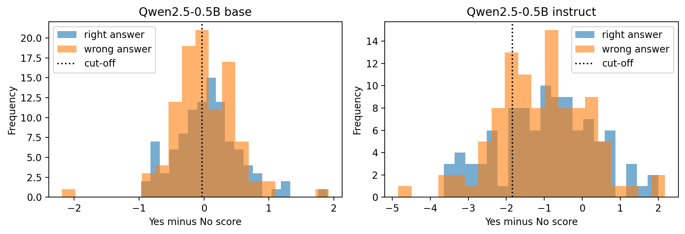

# TARA Pilot Summary Report

## 1. Overview and Timing Estimates
* **Base Model**: Qwen2.5-0.5B base
* **Instruct Model**: Qwen2.5-0.5B instruct
* **Questions in Pilot**: 100
* **Seconds per prompt (Base)**: 0.0341 s
* **Seconds per prompt (Instruct)**: 0.0345 s
* **Estimated Full Run (1000 questions, 6 prompt sets)**:
  - Base Model: 3.4 minutes
  - Instruct Model: 3.5 minutes

## 2. Model Performance and Diagnostics
| Metric | Qwen2.5-0.5B base | Qwen2.5-0.5B instruct |
| :--- | :---: | :---: |
| Best Probing Layer | Layer 18 | Layer 18 |
| Best Probe Accuracy | 0.585 | 0.590 |
| Shuffled-Label Accuracy | 0.495 | 0.470 |
| Template Transfer Accuracy | 0.500 | 0.510 |
| Number of Known Questions | 23 / 100 | 16 / 100 |
| Probe Score Correlation | 0.150 | 0.153 |
| Probe-Unembed Cosine Similarity | 0.032 | 0.049 |

## 3. Performance Visualizations

### Figure 1: Truth-probe accuracy by layer

### Figure 2: Score Distributions

## 4. Behavioral and Probe Effects (Known Questions Only)
*(Note: Pilot results only, not for research findings)*

| Model | Effect | Mean | 95% CI Low | 95% CI High | N (Known) |
| :--- | :--- | :---: | :---: | :---: | :---: |
| Qwen2.5-0.5B base | sycophancy | 0.391 | 0.174 | 0.609 | 23 |
| Qwen2.5-0.5B base | knows_but_agrees | 0.261 | 0.000 | 0.522 | 23 |
| Qwen2.5-0.5B base | belief_shift | -0.140 | -0.504 | 0.259 | 23 |
| Qwen2.5-0.5B instruct | sycophancy | 0.062 | -0.125 | 0.250 | 16 |
| Qwen2.5-0.5B instruct | knows_but_agrees | 0.000 | -0.250 | 0.250 | 16 |
| Qwen2.5-0.5B instruct | belief_shift | 0.298 | -0.532 | 0.993 | 16 |
